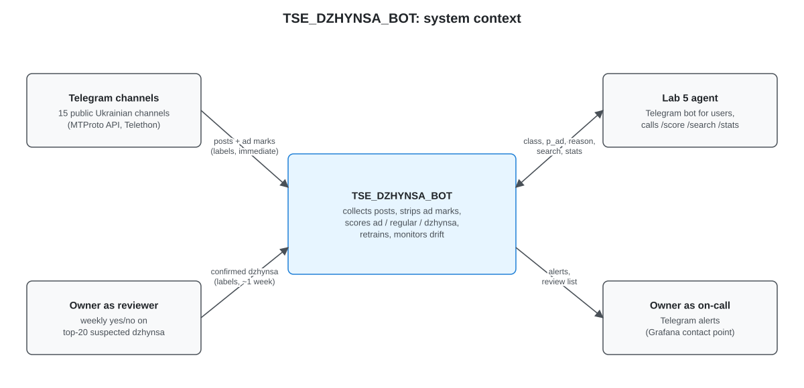
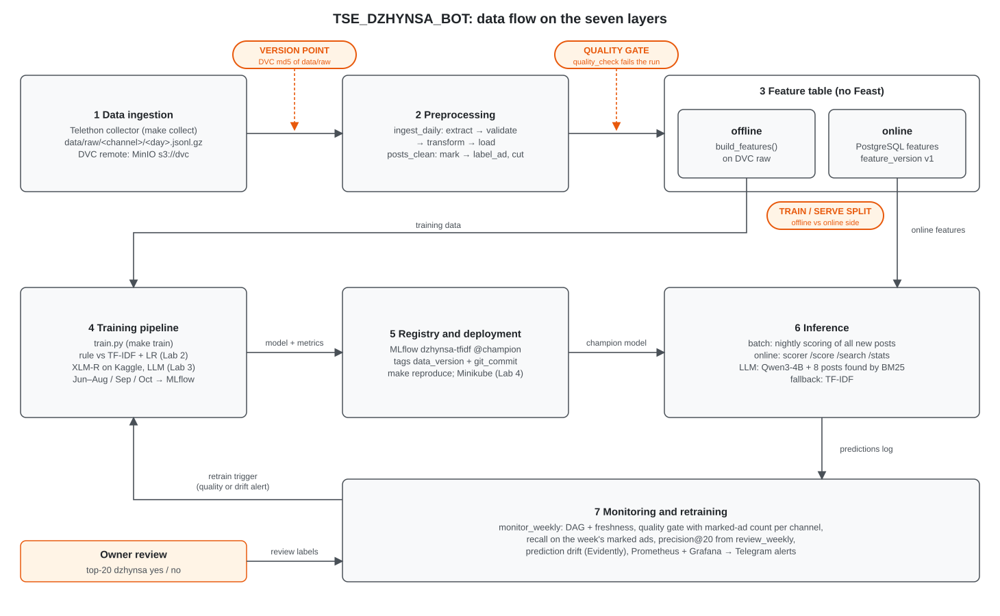
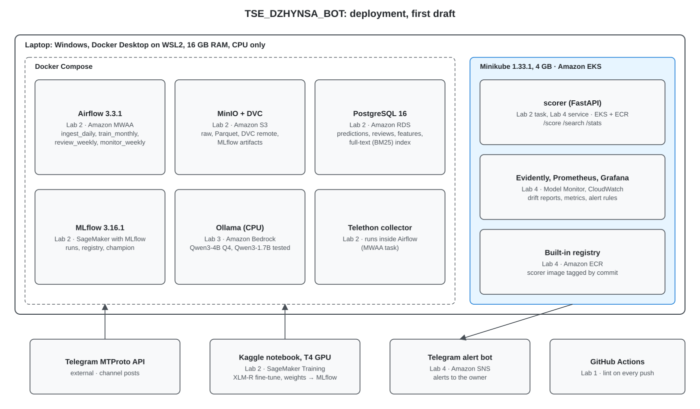

## 1 Overview

Ukrainian Telegram news channels are a major source of news, and some of their posts are paid placements
published without the advertising mark ("джинса"). TSE_DZHYNSA_BOT collects new posts from the most popular public 15 Ukrainian telegram channels once a day and classifies each post into one of three classes: `ad` (the channel marked it as
advertising), `regular`, or `dzhynsa` (not marked ad post, as the model says it reads like an ad). The model learns
what an ad looks like from the ads the channels mark themselves, so no manual labelling is needed: a TF-IDF
baseline, then a fine-tuned multilingual transformer (XLM-R) in Lab 2, then a local LLM that is shown similar posts retrieved from the collected data in Lab 3. The desired
outcome is a weekly list of suspected hidden ads, at least half of which an owner confirms as true, and a
Telegram bot that answers questions about which channels publish them.

## 2 Motivation

**Who consumes the predictions.** Media-monitoring analysts (for example the kind of work IMI and Detector
Media do by hand today), advertisers who want to know how "clean" a channel is before buying a placement, and
readers who want to check a post. In this project the consumer is the owner, through a weekly review list and, from Lab 5, a Telegram bot.

**How often.** About 600 new posts per day (Assumption: 15 channels × 40 posts). Posts are scored once a day; the review list is weekly; the bot can be asked at any time.

**Why a system and not a notebook.** Ad formats, advertisers, promo links and slang change every few weeks, and
channels change how (and whether) they mark ads. A model trained once goes stale, so collection, retraining and
drift monitoring have to run on their own.

**What happens when predictions are wrong.**
- *False `dzhynsa`* (a regular or ad marked post flagged): the reviewer wastes time; if published, an unfair accusation
  against a channel. This is the costly error, so the business metric is precision.
- *Missed `dzhynsa`*: a hidden ad goes unnoticed; nobody is harmed directly, but the channel ranking is too kind.

## 3 Success metrics

| Layer | Metric | Target | Type | How it is measured |
|---|---|---|---|---|
| Business | Precision@20 of `dzhynsa`: share of the week's top-20 suspects the owner confirms (equivalently, false `dzhynsa` ≤ 50 %) | ≥ 50 % | optimizing | weekly review table in PostgreSQL |
| Business | Confirmed `dzhynsa` posts per week | > 10 | satisficing | same review table |
| Model | PR-AUC on `ad` (marked ads with the mark removed vs all other posts), test month | ≥ 0.8 | satisficing | MLflow, every training run |
| Model | Recall on `ad` at the chosen threshold | ≥ 0.80 | satisficing | MLflow |
| Model | Precision on `ad` at the chosen threshold | ≥ 0.70 | satisficing | MLflow |
| System | Freshness: posts of day D are scored by 06:00 Kyiv on D+1 | ≥ 6 of 7 days per week | satisficing | Prometheus, newest scored post at 06:00 |
| System | Nightly DAG success | ≥ 6 of 7 runs per week | satisficing | Airflow run statuses |

Model targets are assumptions until the first baseline run in Lab 2.

## 4 Requirements and constraints

### Functional

| # | Requirement | Caller |
|---|---|---|
| F1 | Collect new posts daily from the channel list; backfill from 2026-06-01 | Airflow `ingest_daily` |
| F2 | Clean, deduplicate, detect and strip ad marks (keeping the mark as the label); a bad batch stops the run | Airflow |
| F3 | Score every post: P(`ad`); assign `ad` by rule if marked, else `dzhynsa` if P ≥ threshold, else `regular` | Airflow → `scorer` |
| F4 | Weekly review list: top-20 `dzhynsa` by probability; the owner marks yes/no | Airflow `review_weekly` |
| F5 | API for the Lab 5 agent: `POST /score`, `GET /search?q=`, `GET /stats?channel=&period=` | agent → `scorer` |
| F6 | Weekly drift report and alerts to the owner | Airflow `monitor_weekly` |

### Non-functional

| Category | Requirement |
|---|---|
| Freshness | Daily batch; predictions at most one day behind the channels. |
| Latency and throughput | ~600 posts/day. Nightly scoring of a day's posts ≤ 10 min (XLM-R on the laptop CPU, Assumption, measured in Lab 2). `/score` p95 ≤ 1 s with XLM-R, ≤ 20 s with the LLM on CPU; `/search` p95 ≤ 500 ms. |
| Availability and fallback | One laptop, no uptime promise. Model cannot load → TF-IDF answers (`model=tfidf`). LLM down → XLM-R answers. |
| Reproducibility | Git commit + DVC data version + MLflow run id; environment pinned by `uv.lock`. |
| Adaptability | New data via the daily DAG; new models via the MLflow alias `champion`; channels and ad-mark patterns in `configs/*.yaml`. |
| Observability without ground truth | `ad` labels are immediate, so model quality is checked weekly. `dzhynsa` truth comes ~1 week later from the review. In between: prediction drift and a per-channel counter of marked ads. |
| Cost and resource ceilings | One Windows laptop, CPU only, 16 GB RAM (Assumption); Minikube 4 GB; XLM-R is fine-tuned on a free Kaggle GPU (T4, 30 h/week); LLM ≤ 4B quantized on CPU (Qwen3-4B Q4 by default). Cloud ≤ 50 USD/month (6.7). |

**Conflict:** freshness vs cost. Running the LLM on every post as it arrives would keep the laptop CPU busy all day, so cost wins: daily batch.

| In scope | Out of scope |
|---|---|
| Text of public Ukrainian channels; classes `ad` / `regular` / `dzhynsa`; TF-IDF, XLM-R and LLM models; API; drift monitoring; retraining. Telegram bot agent in Lab 5. | Russian channels, images and video, comments, private channels, legal verdicts, naming advertisers. |

## 5 Methodology

### 5.1 Problem statement

- **Definition.** As media watchdogs (IMI, Detector Media) use it, `dzhynsa` is any paid material without the ad mark, commercial or political. Political promotion is a subtype, not a separate label; the LLM's `reason` shows it during review.
- **Framing.** Binary classification "does this post read like an ad", trained on marked ads with the mark removed, then applied to unmarked posts. Output: marked → `ad`; unmarked and P ≥ threshold → `dzhynsa`; otherwise `regular`.
- **Rejected framing.** Three classes on hand labels (LLM silver + human gold): hidden ads are hard to recognise even for people, so the labels would be noisy and expensive.

### 5.2 Data

| Item | Decision |
|---|---|
| Sources | 14 public Ukrainian channels (news and political, "Труха" / "Інсайдер UA" kind), Telethon with a separate account; list in `configs/channels.yaml`. Fields: channel, id, date, text, views, forwards, forward source, links, edit date. No media. |
| Arrival | Backfill 2026-06-01..2026-10-27 (`make backfill`; ~5 months keep the laptop disk small), then daily (`make collect`, re-reads the last 3 days for edits). |
| Batch grain | one Kyiv day: `data/raw/<channel>/<YYYY-MM-DD>.jsonl.gz`, rewritten whole and sorted by id, so the same day gives the same bytes. The DAG run's logical date picks the day. |
| Data version | DVC md5 of `data/raw` (in `data/raw.dvc`), remote MinIO `s3://dvc`; logged as `data_version` on every MLflow run. |
| Split | Train 2026-06..08, validation 2026-09, test 2026-10-01..27; live from 2026-10-28. |
| Formats | Raw JSONL.gz (DVC → MinIO); clean posts in PostgreSQL `posts_clean`, features in `features` (one row per post and `feature_version`); predictions, reviews and full-text index in PostgreSQL. |
| Training vs serving | Training: full history, labels, point-in-time channel stats. Serving: the new post (mark removed) and online features, no labels. |

| Label | Source | Delay | Use |
|---|---|---|---|
| `ad` | the channel's own mark (`#реклама`, "на правах реклами", "партнерський матеріал"; regexes in `configs/ad_marks.yaml`), cut from the text | immediate | training, test, weekly check |
| `dzhynsa` confirmed | owner's yes/no on the weekly top-20 | ~1 week | business metric, threshold, training (yes → positive, no → hard negative) |
| `dzhynsa` seed set | ~50 clear hidden ads collected by the owner before Lab 2 | once | test of transfer, never trained on |

**Will a model trained on marked ads find unmarked ones?** Not guaranteed. Safeguards: (1) the weekly review feeds back into training; (2) recall on the seed set is checked before launch; (3) top TF-IDF features are inspected for leftovers of the mark; (4) the LLM's system prompt describes `dzhynsa` directly.

**Checklist.** Time axis: every post has a timestamp. History: ~5 months, holdout = October 1-27 (test), September (validation). Label delay: `ad` immediate, `dzhynsa` ~1 week. Text corpus: the posts themselves (Lab 3 retrieval). Risk: channels that rarely mark ads are replaced after the Lab 2 count.

### 5.3 Techniques

| Model | Lab | What it is | Role |
|---|---|---|---|
| Hand rule | 2 | `ad` if the post has a promo code, a phone number, a shop or bot link, or words like «знижка», «замовляй», «переходь за посиланням» | rule baseline the trained models must beat |
| TF-IDF + logistic regression | 2 | word and character n-grams | baseline to beat; fallback in serving |
| XLM-R | 2 | `xlm-roberta-base` fine-tuned as a binary classifier in a Kaggle notebook on a T4 GPU (max length 256, batch 16), weights imported into MLflow, inference on CPU | main model |
| LLM | 3 | Qwen3-4B Q4 via Ollama: a system prompt with the definition and signs of `dzhynsa` (one-sided praise, call to action, contacts or promo codes, unusual topic for the channel, same text in several channels) + 8 similar labelled posts found by BM25; returns JSON `{is_ad, p, reason}` | challenger; explains its answer |

All models are compared on the same test month; the best becomes `champion`. Prompts are versioned in `prompts/`. Lab 3 compares: prompt only, prompt + retrieved examples, best of these vs XLM-R.

| Feature | Training source | Serving source |
|---|---|---|
| `text_clean` (post with the ad mark cut) | `build_features()` on DVC raw | the request text (`/score`) or the new post in `posts_clean`, same function |
| `n_links`, `has_invite_link`, `has_promo_code`, `has_phone`, `text_len`, `is_forward`, `hour_of_day` | same function on the raw post | the request itself; regexes in code, version = `feature_version` |
| `channel_ad_rate_30d` (share of marked ads in the channel's previous 30 days, today excluded) | rolling window over DVC raw, point-in-time | warehouse lookup: `features` row written by `ingest_daily.build_features` for that day |
| `search_index` (LLM retrieval only, Lab 3) | clean text | PostgreSQL full-text index, updated daily |

Training and the DAG call the same `features.py`, so the only training-serving difference is where the 30-day history is read from (DVC files vs `posts_clean`).

### 5.4 Experimentation and validation

| Item | Decision |
|---|---|
| Split | by time: train 2026-06..08, validation 09, test 2026-10-01..27 (`train.py`); a random split would put reposts of the same ad on both sides |
| Baseline | the hand rule and TF-IDF + LR are logged as two MLflow runs on the same test month and compared side by side in the README |
| Reproduction | `make reproduce` checks out the champion's `git_commit`, pulls its `data_version` with DVC, retrains; test PR-AUC must match within ±0.01 |
| Offline metric | PR-AUC on `ad`, plus recall and precision at the threshold; recall on the seed set; all in MLflow |
| `dzhynsa` threshold | set on validation so `ad` precision ≥ 0.70, then tuned from the review |
| Promotion | new PR-AUC ≥ current, recall drop ≤ 0.05, seed-set recall not lower; owner confirms |

### 5.5 Human in the loop

The owner reviews the weekly top-20 (answers become labels), acts on alerts (retrain, change threshold, replace a channel), approves promotion by moving the MLflow alias, and can override any prediction (`source=manual`).

## 6 Implementation

### 6.1 High-level design

The diagrams use the component names of 6.2. Orange marks on the data flow: version point, quality gate, train/serve split.

### 6.2 Infra

| Component | Local reference | Role | From | AWS equivalent |
|---|---|---|---|---|
| MinIO | `pgsty/silo:RELEASE.2026-09-16T00-00-00Z` | raw, Parquet, DVC remote, MLflow artifacts | Lab 2 | Amazon S3 |
| DVC | 3.67.1 + dvc-s3 3.3.0 | versions of raw data and labels | Lab 2 | S3 remote |
| PostgreSQL | 16, built-in full-text search | databases `warehouse` (`posts_clean`, `features`, later predictions, reviews, search index), `airflow`, `mlflow` | Lab 2 | Amazon RDS |
| Airflow | 3.3.1, LocalExecutor | `ingest_daily`: extract → validate → transform → load → build_features → quality_check (Lab 2; scoring added in Lab 4); later `train_monthly`, `review_weekly`, `monitor_weekly` | Lab 2 | Amazon MWAA |
| MLflow | 3.16.1, backend PostgreSQL, artifacts MinIO `s3://mlflow` (proxied by the server) | runs, metrics, registry (`dzhynsa-tfidf@champion`) | Lab 2 | SageMaker with MLflow |
| Ollama | Qwen3-4B Q4 on CPU (1.7B compared in Lab 3) | LLM classifier (Lab 3), agent's LLM (Lab 5) | Lab 3 | Amazon Bedrock |
| scorer | FastAPI image | `/score`, `/search`, `/stats` | Lab 2 task, Lab 4 service | EKS + ECR |
| Evidently | in `monitor_weekly` | drift report | Lab 4 | SageMaker Model Monitor |
| Prometheus, Grafana | Prometheus, Grafana | metrics, dashboards, alert rules | Lab 4 | CloudWatch |
| Registry | Minikube built-in | `scorer` image by commit | Lab 4 | Amazon ECR |
| Alerts | Telegram via Grafana | alerts and the weekly review list | Lab 4 | Amazon SNS |
| Agent | Telegram bot, Qwen3-4B via Ollama with tool calling | answers questions using `/score`, `/search`, `/stats` | Lab 5 | Bedrock + EC2 |

Cluster: Minikube 1.33.1 (Kubernetes 1.30.0, 4 GB) ≈ Amazon EKS; only `scorer` and monitoring run in it, the rest in Docker Compose (`make up`: postgres, minio, mlflow, airflow). Tooling: uv, ruff, pre-commit, GitHub Actions.

### 6.3 Performance

Nightly run starts at 01:00 Kyiv and must finish by 06:00. Batch for scoring (a weekly review needs only daily freshness); online only for the agent's API calls.

| Step | Budget |
|---|---|
| Telethon collection, 14 channels | 10 min |
| Clean, dedup, strip marks, quality gate, features, search index | 5 min |
| XLM-R scoring of ~600 posts (CPU) | ≤ 10 min |
| LLM (Lab 3+): only unmarked posts with XLM-R P ≥ 0.2, ~100 × ~10 s on CPU | 17 min |
| **Total** | **≤ 45 min** |

Monthly training: TF-IDF in minutes on CPU; XLM-R on a subsample ≤ 1 h on the Kaggle T4 GPU (Assumption, measured in Lab 2); the training Parquet is uploaded as a private Kaggle dataset named by its DVC version, and `make import-xlmr` logs the notebook's model and metrics into the local MLflow with that data version and the commit.

### 6.4 Security

| What | How |
|---|---|
| Secrets (Telegram keys and session, bot token, DB and MinIO passwords) | git-ignored `.env` (`.env.example` has only local defaults; Telegram keys stay with the owner, the DAG never needs them); Kubernetes Secrets from Lab 4; AWS Secrets Manager in the cloud |
| Who may call `scorer` | only inside the cluster or via port-forward (Airflow, the agent) |
| Web UIs (Airflow, MLflow, Grafana) | localhost, password |
| Collector account | separate Telegram account |

### 6.5 Data privacy

| What | How |
|---|---|
| Personal data | public posts only; no comments, subscribers or media |
| Defamation | a `dzhynsa` label is a suspicion; nothing published without the owner's review; the bot says "suspected" and gives the reason |
| Retention | raw posts for the course + 12 months (DVC); predictions 12 months; deleted posts marked deleted |
| Terms | non-commercial study; raw data never published |

### 6.6 Monitoring and alarms

Logged per post: `post_id`, channel, date, has_mark, P(`ad`), class, `model_version`, LLM reason.

| # | Check | Metric | Alert when | Action |
|---|---|---|---|---|
| 1 | System works | DAG status, newest scored post, `scorer` errors and p95 | DAG failed or late; no posts from yesterday; errors > 1 % | rerun or roll back |
| 2 | Data is sane | quality gate + marked ads per channel | a check fails; a channel's marked-ad count changes > 2× | fix source or drop the channel |
| 3 | Model still recognises ads | recall and PR-AUC on the week's marked ads | recall < 0.70 or PR-AUC < 0.80 | retrain, owner approves |
| 4 | `dzhynsa` flags are useful | precision@20 from the review | < 40 % two weeks in a row | raise threshold or retrain |
| 5 | Prediction drift | share of posts predicted as ads vs previous 4 weeks (Evidently) | change > 2× | check examples |

Retraining: monthly, plus when check 3 or 5 fires.

### 6.7 Cost

AWS on-demand list prices, us-east-1, 730 h/month (Assumption: re-check in the AWS Pricing Calculator).

| Where | What | USD/month |
|---|---|---|
| Laptop | Airflow, Telethon, MinIO, PostgreSQL, MLflow, Ollama, TF-IDF training, monitoring | electricity ≈ 3 |
| Kaggle | XLM-R fine-tuning on a T4 GPU, free tier | 0 |
| EC2 t4g.medium | `scorer` (XLM-R on CPU), Lab 5 bot, small copy of predictions and search index | 30 |
| S3 | nightly backups, DVC remote copy | 1 |
| Bedrock | agent's LLM when the laptop is off, ~300 questions | 2 |
| CloudWatch | 2 alarms | 1 |
| **Total** | | **≈ 34** |

### 6.8 Integration points

| Party | Contract |
|---|---|
| Telegram channels (upstream) | post fields as in 5.2; no SLA; FloodWait limits |
| Collector → pipeline | one JSONL.gz per channel and day with `channel`, `id`, `date`, `text` required; `validate` fails on a missing column, `quality_check` on too few rows or channels, too many empty texts, ad share > 0.5 (`configs/quality.yaml`) |
| Pipeline → training and `scorer` | `features` table keyed by (`channel`, `id`, `feature_version`); MLflow model `dzhynsa-tfidf@champion` with tags `data_version`, `git_commit`, `threshold` |
| Weekly review (labels) | 20 posts/week, yes/no, stored with threshold and model version |
| Lab 5 agent (downstream) | `/v1/score {text}` → `{class, p_ad, reason}`; `/v1/search?q=&channel=` → posts with `t.me` links; `/v1/stats?channel=&period=` → counts per class |
| Alerts (downstream) | Telegram message: signal, value, threshold, link to the report |

### 6.9 Risks and uncertainties

| Risk | Mitigation |
|---|---|
| Channels rarely mark ads | count marks per channel in Lab 2, replace channels with ~0 |
| Model does not transfer from marked to unmarked ads | review feedback loop, seed-set recall, LLM system prompt; precision@20 shows it in 2 weeks |
| Political `dzhynsa` learned worse (marked ads are mostly commercial) | political signs in the system prompt; stated limitation |
| Model learns channel style | per-channel F1; no `channel_id` feature |
| Mark missed by the regex | review false `dzhynsa`, extend `ad_marks.yaml` |
| Unfair accusation | "suspected" wording, owner review |
| Collector banned | separate account, one pass a day, FloodWait backoff |
| LLM breaks JSON | schema check, retry, fall back to XLM-R |
| Laptop off at night (travel) | Airflow `catchup`, Telethon resumes from the last id |
| No local GPU; Kaggle quota or session limits | training on a subsample, checkpoints saved; DistilBERT multilingual as fallback; TF-IDF stays the fallback in serving |
| LLM slow on CPU | only posts with P ≥ 0.2; Qwen3-1.7B if 4B is too slow |

## 7 Appendix

### 7.1 Alternatives

| Alternative | Why rejected |
|---|---|
| LLM silver + human gold for three classes | noisy, hundreds of posts to check by hand |
| Zero-shot LLM on every post | too slow for 600 posts/day on a laptop CPU; nothing to retrain |
| TF-IDF as the only model | misses new phrasings; kept as baseline and fallback |
| Russian channels (legal `erid` mark) | clean labels, but not the owner's market |
| e5 embeddings + pgvector | extra model and service, harder to explain; BM25 in PostgreSQL instead |
| Feast | a service for a handful of features |
| vLLM | needs a GPU; Ollama runs on CPU |

### 7.2 Experiment results

Test 2026-10-01..27, MLflow experiment `dzhynsa-lab2`. Filled after the real backfill (Assumption until then).

| Model | PR-AUC | Precision | Recall | F1 |
|---|---|---|---|---|
| Hand rule | | | | |
| TF-IDF + LR | | | | |

### 7.3 Performance benchmarks

Placeholder: Lab 4.

### 7.4 Milestones

- **Lab 2:** Telethon backfill and daily DAG, DVC, quality gate, ad-mark labels, TF-IDF and XLM-R in MLflow.
- **Lab 3:** BM25 search index, LLM with system prompt and retrieval, comparison with XLM-R.
- **Lab 4:** `scorer` on Minikube, Evidently, Prometheus/Grafana alerts, an injected drift that reaches the owner.
- **Lab 5:** Telegram bot agent (Qwen3-4B with tool calling) on top of `/score`, `/search`, `/stats`.

### AI usage

AI assistants (Claude) were used to discuss design options and draft this document and the repository.
